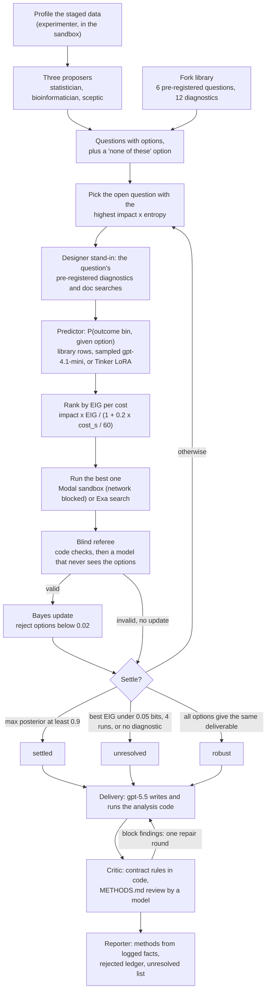
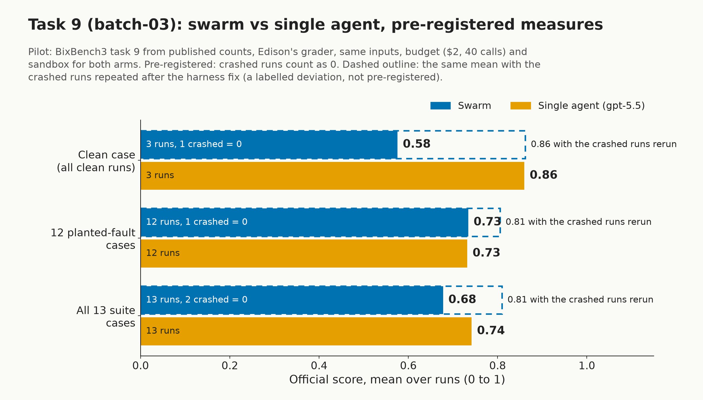
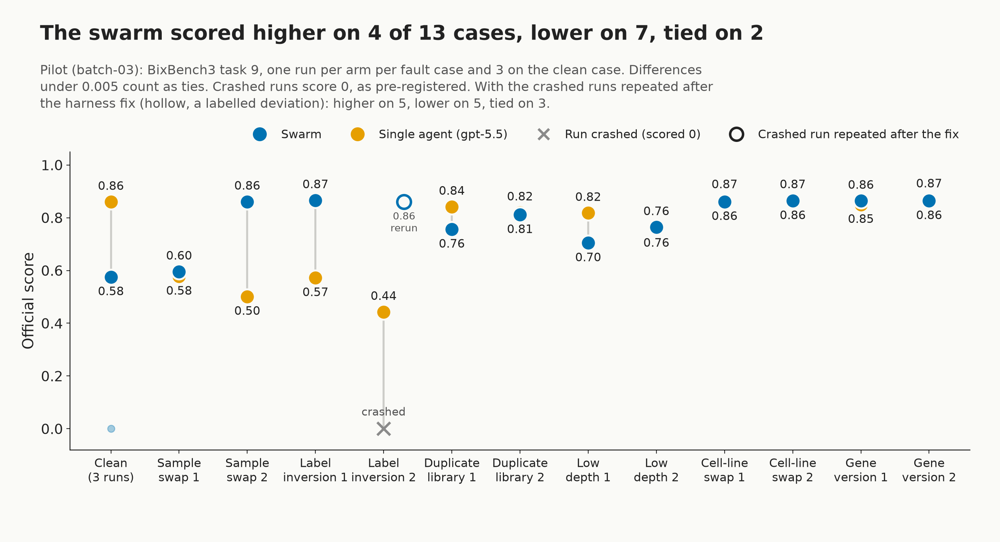
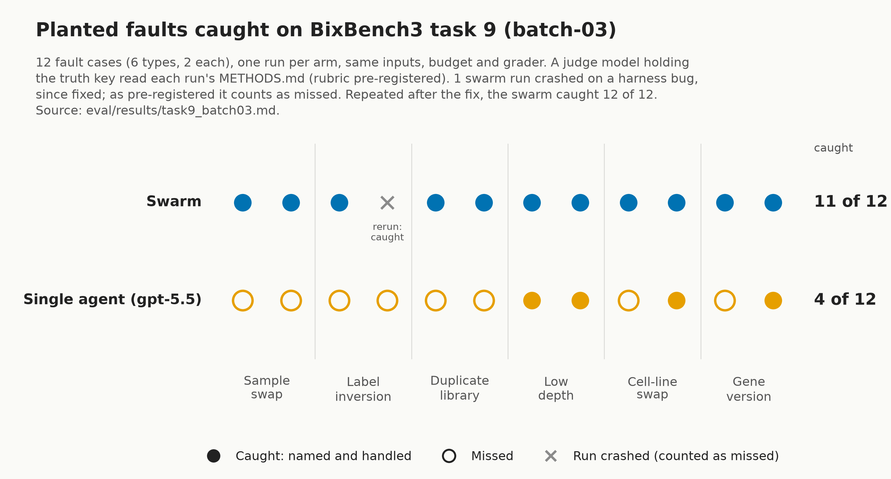

# Crux

Crux is a team of AI scientists that settles disagreements by running the most informative experiment instead of voting. Proposers raise competing options for an analysis choice. A predictor states what each option expects from each diagnostic. The orchestrator runs the diagnostic with the most expected information per cost in a network-blocked Modal sandbox, and a blind referee validates the result before a Bayes update. Questions settle only on evidence, or are reported unresolved, and every rejected option keeps the evidence that rejected it. A run can be replayed and checked from its event log alone.

Our main test is BixBench3 task 9: differential expression from a published count matrix. We also point the same engine at four claims from the DESeq2 paper (the claims audit MVP) and at a simulated design task from BoxingGym.

Built at the SF AI Research Hackathon, Track 3 (AI Scientist Swarms). The submission write-up is in [docs/SUBMISSION.md](docs/SUBMISSION.md). The engineering plan is in [docs/ERD.md](docs/ERD.md) and the event contract in [docs/EVENTS.md](docs/EVENTS.md).

## How it works



Every hard rule lives in code, not in a prompt. The loop is `core/orchestrator.py`:

1. **Profile and propose.** `_Run._main` profiles the data (`labs/bixbench3/task9.py`, `Task9Lab.profile`) and calls the proposers (`agents/proposer.py`, wired in `agents/swarm.py`, `SwarmRoles.propose`). The six library forks come from `diagnostics/de_from_counts/library.py` (`library_questions`): swapped labels, duplicate libraries, degraded libraries, wrong cell line, mixed gene-ID versions and inverted groups. `_init_options` adds a "none of these" option with prior 0.15 (`core/config.py`). Since PR #54, a malformed merge plan keeps every proposal unmerged instead of ending the run.
2. **Choose a question and a diagnostic.** `_categorical_loop` takes the open question with the highest impact x entropy. `_question_round` asks the designer for candidates, `_fill_likelihoods` asks the predictor for P(bin | option) (`agents/predictor.py`, `agents/tinker_predictor.py`), `_separates` drops candidates on which every option predicts the same thing, and `_rank` scores the rest by expected information gain per cost (`core/scoring.py`, `core/eig.py`). Since PR #38 the predictor makes one joint call when sampling would pass 8 calls (`eval/results/task9_protocol_batch03.md`).
3. **Run, referee, update.** `_run_categorical` runs the winner in the sandbox (`execution/sandbox.py`) or, for a search, `_run_search` calls Exa. Outcome bins are computed by code from the script's `RESULT:` line, never chosen by a model. The blind referee (`agents/referee.py`) checks the run before `_apply` makes the Bayes update. `_reject_low` rejects options below posterior 0.02 and records the evidence id.
4. **Stop.** `_check_closed` settles a question at posterior 0.9. `_unresolve` gives up when the best EIG is under 0.05 bits, after 4 experiments, when no informative diagnostic exists or when every option is rejected. `_check_robust` closes a question when all remaining options lead to the same deliverable.
5. **Deliver and critique.** `_deliver_and_critique` asks the delivery planner (`agents/deliverer.py`) for code, runs it, and sends the artifacts to the critic (`agents/critic.py`). Since PR #47, an unresolved question that a diagnostic tested uses its best-supported option, and one that no diagnostic tested keeps the method's documented defaults (`eval/results/task9_protocol_batch03.md`). A blocking finding triggers one repair round (`max_critic_rounds = 2`, including the first). The reporter (`agents/reporter.py`) writes the methods only from logged facts; prose that cites a number not in the facts is replaced by a template.

Two parts are still stand-ins, and we say so in every result. There is no `designer.py`: the designer is `SwarmRoles.design` in `agents/swarm.py`, which returns the pre-registered diagnostics attached to a question and ignores everything else, including recalled memory. Surprise-driven regeneration returns no new options in the swarm (`SwarmRoles.regenerate`). Questions the proposers raise without a library or search diagnostic therefore end unresolved.

## What is real and what is synthetic

| Part | Real | Synthetic or stand-in |
| --- | --- | --- |
| Task 9 input | The published Tag-Seq count matrix (60,708 genes, 16 samples) and sample sheet from GSE234912 (`eval/results/task9_runs.md`) | The fault suite plants faults into copies of that matrix (`eval/suites/task9/make_cases.py`) |
| Grading | Edison's deterministic grader at commit `d0e0bbb`, run outside the agent's folders (`eval/grade_bixbench3.py`); in batch-03, inside the Modal orchestrator container (`docs/CLOUD.md`) | |
| Prompt | | A local fallback prompt (`labs/bixbench3/task9_contract.py`, `load_prompt`); the official `agent/prompt.md` is in a gated dataset we could not read |
| Models | gpt-4.1-mini and gpt-5.5 through the OpenAI API (`agents/llm.py`) | Offline tests and the `fake*` labs use scripted roles (`core/fakes_engine.py`) |
| Execution | Modal sandboxes with R 4.5 and DESeq2 (`execution/image.py`) | `--case` runs on this machine for development only (`execution/local.py`) |
| Diagnostics | Run on 3 public datasets (`eval/results/real_data_diagnostics.md`) | Thresholds were first tuned on simulated counts (`diagnostics/de_from_counts/synth.py`) |
| Predictor | Tested on a held-out real dataset with planted faults (`eval/results/predictor_real_data.md`) | The DU-29 fine-tune was trained only on simulated cases (`eval/results/predictor_calibration.md`); the DU-54 fine-tunes add two real datasets |
| Memory and search | Live past.dev and Exa adapters. One separately labelled, officially graded run used both (`tools-run-02`, `eval/results/task9_batch02.md`); every batch stripped both | The memory replay and lesson fixtures are synthetic plumbing data (`eval/fixtures/`) |
| Claims audit | SymPy derivations and NumPy/SciPy simulations run for real (`docs/CLAIMS.md`) | Four hand-curated claims; a simplified Wald test; deterministic code roles |
| BoxingGym study | The real numeric orchestrator, with gpt-4.1-mini proposing source models (`docs/BOXING_STUDY.md`) | A simulator, not scientific data (`eval/results/boxing/README.md`) |
| Designer, regeneration | | Stand-ins (`agents/swarm.py`) |
| UI and site | Replay real runs, including the first graded Task 9 run and the claims run (`runs/demo/`) | `web/fixtures/demo.jsonl` is a scripted synthetic run; the site's offline fallback is a hand-written fixture (`site/README.md`) |

## Results (pilot: one task, from published counts)

**Scope.** Everything in this section is BixBench3 task 9, one task of 20, starting from the published count matrix (Edison's artifact 1), not raw reads. Edison's deterministic grader at commit `d0e0bbb` scores the 9 required artifacts, and a run's score is their mean. These numbers are **not comparable** to the 0.523 full-suite record, which starts from raw data (`eval/results/task9_runs.md`). The comparison is a single ReAct agent on gpt-5.5 (`eval/baseline_agent.py`) with the same inputs, prompt, Modal image, grader, $2 cap and 40-call limit (`eval/results/task9_protocol.md`).

### Batch-03 (latest)

Pre-registered in PR #48 before any run (`eval/results/task9_protocol_batch03.md`). Code commit `19cd67c`, launch id `batch-03`, with orchestration, sandboxes and grading all in Modal (PR #49). The launch had 52 runs (`eval/results/task9_protocol_batch03.md`):

- the 13-case suite for both arms, one run per arm per case: the clean case plus 2 each of six planted faults (`make_cases` seed 43);
- 2 more clean-case runs per arm;
- a lessons arm on the 9 held-out test cases;
- a random-selection arm on all 13 cases.

Inputs include the task's own `gencode.v38` symbol map. Exa and past.dev were stripped from every arm, and failed runs count as 0. The 52 runs cost $56.93 against the $100 cap, and no run was skipped for budget (`eval/results/task9_batch03.md`).

**Pre-registered numbers (crashed runs count as 0)**, from `eval/results/task9_batch03.md`:

| Measure | Swarm | Single agent (gpt-5.5) |
| --- | --- | --- |
| Clean case, 3 runs | 0.576 (0.000, 0.861, 0.866) | **0.860** (0.861, 0.866, 0.853) |
| 12 fault cases | 0.734 ± 0.246 | 0.732 ± 0.160 |
| All 13 suite cases | 0.678 ± 0.311 | 0.742 ± 0.158 |
| Paired difference, 13 cases (95% CI) | −0.064 (−0.242 to 0.080) | |
| Per case: swarm higher / lower / tied | 4 / 7 / 2 | |
| **Faults caught / noticed only / missed, of 12** | **11 / 0 / 1** (the miss is a crashed run) | 4 / 2 / 6 |
| Failed runs | 2 (merge-step crash: case-04, case-05) | 0 |
| Runs stopped by the $2 cap, still graded | 1 | 6 |
| Mean cost, calls, median time per suite run | $0.93, 16.5, 278 s | $1.34, 18.8, 305 s |

**Labelled deviation: the three crashed swarm runs, rerun.** Three swarm runs (suite case-04 and case-05, lessons case-07) crashed on a bug in our merge step: the merge model put an option under the wrong question, and the code raised instead of dropping the bad grouping. PR #54 fixed it. The three runs were repeated once at commit `8ffac76`, with the same inputs, models and caps, for $3.43. This is the same treatment the single agent's crashes got in batch-02. These numbers sit next to the pre-registered ones, never in place of them (`eval/results/task9_batch03.md`):

| Measure | Swarm, crashed runs rerun | Single agent |
| --- | --- | --- |
| Clean case, 3 runs | **0.862** (0.861, 0.861, 0.866) | 0.860 |
| 12 fault cases | 0.806 ± 0.086 | 0.732 ± 0.160 |
| All 13 suite cases | 0.810 ± 0.084 | 0.742 ± 0.158 |
| Paired difference, 13 cases (95% CI) | +0.068 (−0.013 to 0.167) | |
| Per case: higher / lower / tied | 5 / 5 / 3 | |
| **Faults caught, of 12** | **12** | 4 (plus 2 noticed) |
| Lessons on minus off, 9 test cases (95% CI) | +0.010 (−0.059 to 0.089) | |
| Information-gain minus random selection, 13 cases (95% CI) | −0.000 (−0.001 to 0.001) | |
| Mean cost per suite run: information gain vs random | $1.13 vs $1.14 | $1.34 |

Intervals are 95% bootstrap intervals over cases (10,000 resamples, seed 0).

What these numbers say, and don't:

- **The clean-case gap closed.** On finished runs the swarm scored 0.862 against 0.860. Pre-registered it did not, because one swarm clean run crashed and counts as 0 (0.576). The fix behind it (PR #47: an untested question keeps the method's defaults) was written after seeing clean-case grades, so clean-case scores count as tuned.
- **Fault handling is the clear difference.** The swarm caught 12 of 12 planted faults (11 pre-registered). The single agent caught 4 and named 2 more without acting on them. Where it missed a label inversion or a sample swap, it kept the labels as given and scored 0.443 to 0.578; the swarm relabelled and scored 0.861 to 0.866.
- **The caveat on faults.** The swarm's library has checks for exactly the six fault types the suite plants. So this shows that a check library inside the loop catches the faults it was written for. It does not show detection of fault types nobody wrote a check for.
- **Overall scores are statistically tied.** The paired interval includes zero, pre-registered (−0.242 to 0.080) and with the reruns (−0.013 to 0.167).
- **Random experiment selection did as well as information-gain selection.** With the crashed runs rerun, scores were identical (0.810 vs 0.810), cost was the same ($1.14 vs $1.13 per run), and random caught 11 of 12 faults against 12 (11 pre-registered). Crux's selection rule showed no measurable advantage on this suite. With about a dozen library diagnostics and a $2 budget, random order still reaches the diagnostics that matter. The BoxingGym study (below) found no advantage either.
- **Lessons on vs off had no measurable effect.** The difference was +0.010 on the 9 held-out cases (95% CI −0.059 to 0.089). The six lessons were drafted from the four dev cases' own runs, reviewed and frozen before the launch (`eval/lessons/`). The reviewer had seen batch-02's test-case results.
- **Small samples.** One run per arm per fault case. The single agent hit the $2 cap in 6 of 13 suite runs and was still graded.
- **The seed-43 cases have now been seen twice.** Batch-04, a fresh held-out suite (`make_cases` seed 44, 26 runs, $45 cap), was pre-registered in PR #59 before it ran (`eval/results/task9_protocol_batch04.md`). Its results are not in this write-up.







### The earlier batch: batch-02

Pre-registered before any run, at code commit `799febd` (`eval/results/task9_protocol_batch02.md`). It used the same 13 cases, the `gencode.v38` symbol map and the shared prompt rule (PR #30), with Exa and past.dev stripped from both arms (`eval/results/task9_batch02.md`):

| Measure | Swarm | Single agent, pre-registered | Single agent, 4 crashed runs rerun |
| --- | --- | --- | --- |
| Clean case, 3 runs | 0.833 ± 0.038 (0.850, 0.790, 0.861) | **0.868 ± 0.002** | (no clean run crashed) |
| 12 fault cases | 0.780 ± 0.101 | 0.452 ± 0.361 | 0.730 ± 0.160 |
| All 13 suite cases | 0.785 ± 0.099 | 0.484 ± 0.365 | 0.741 ± 0.158 |
| Paired difference, 13 cases (95% CI) | | 0.301 (0.123 to 0.488) | 0.045 (−0.049 to 0.148) |
| Faults caught, of 12 | 12 | 3 | 5 |

The four single-agent crashes were a bug in our harness: gpt-5.5 spent its whole 4,096-token output cap on reasoning, and the baseline loop did not catch `LengthFinishReasonError`. PR #40 fixed it (`eval/results/task9_batch02.md`). The batch-02 charts are in `docs/figures/task9_*.png`.

### Progression: run 1 to batch-03

The inputs and the prompt changed between these runs, so this is not a learning curve.

| Runs | Inputs and prompt | Swarm | Single agent | Source |
| --- | --- | --- | --- | --- |
| Run 1, `r-20261114-175926-6050` | Counts and sample sheet, no gene annotation (bundle `160253fe…`); before the shared prompt rule | 0.586 (5 of 9 at or above 0.80) | not run | `eval/results/task9_runs.md` |
| batch-01, 3 swarm runs | Same bundle; before the shared prompt rule | 0.628 ± 0.046 (0.650, 0.576, 0.659) | stopped early, not graded | `eval/results/task9_batch01.md` |
| Paired clean case (DU-22), 1 run per arm | Counts, sample sheet, GENCODE v43 symbol map; the shared rule was written after this pair was graded | 0.727 (3 of 9) | **0.862** (8 of 9) | `eval/results/task9_runs.md` |
| batch-02 clean, 3 runs per arm | The task's own `gencode.v38` map; shared prompt rule (PR #30) | 0.833 ± 0.038 | **0.868 ± 0.002** | `eval/results/task9_batch02.md` |
| batch-03 clean, 3 runs per arm | As batch-02, plus untested questions keep method defaults (PR #47) | 0.576 pre-registered; **0.862** with the crashed run rerun | 0.860 | `eval/results/task9_batch03.md` |

- **No annotation meant two zeros.** In run 1 and batch-01, the two shared-gene lists scored 0 by construction. They are keyed by gene symbol, and those inputs had no annotation. Every run's METHODS.md said so before grading (`eval/results/task9_batch01.md`).
- **Where the DU-22 gap came from.** On C10 versus control, the baseline fit one model across all T98G conditions and recovered all 1,232 reference significant genes; the swarm refit a model per treatment-control pair and recovered 427 (`eval/results/task9_runs.md`). The shared prompt rule "one DESeq2 fit per cell line" came out of this.
- **Run 1's config overstates its tools.** Run 1's `run.started` config lists `memory: "pastdev"` and `search: true`, but neither was connected: the Exa and past.dev integrations were not merged yet (`eval/results/task9_protocol.md`). Since PR #38, `manifest.json` records `tools_connected`, what the run actually had, next to the config (`core/manifest.py`).

### Also run, separately labelled: search and memory on (tools-run-02)

One swarm run on the clean case with Exa search and past.dev memory connected, after PR #38. Official score **0.815** (8 of 9 artifacts at or above 0.80), 26 model calls, $1.05 (`eval/results/task9_batch02.md`). Its event log is `runs/demo/task9_tools_run2.jsonl`:

- Three Exa searches were chosen and run (`search.done`). `search-independent_filtering` rejected an option on the pre-filtering question, "use DESeq2's internal independent filtering only", at posterior 0.0172.
- The critic recalled 8 records, all written by the referee, into its review prompt (`memory.recalled`).
- Recall latency over the 25 logged recalls: p50 569 ms, p95 979 ms (interpolated percentile, `memory/instrumentation.py`), slowest 1,808 ms.

One run, in line with the tools-off clean runs of batch-02 (0.790 to 0.861), so we claim no score effect either way.

### Diagnostics on real public data

From `eval/results/real_data_diagnostics.md` (3 public datasets, 4 cases, the 12 library diagnostics):

- **Planted faults:** 26 of 30 caught. All 4 misses are label inversions on single-line designs, where the direction checks abstain by design. One false alarm in 33 cases. Two instances per fault per dataset is a sanity check, not a benchmark. 
- **A real finding:** in GEO GSE52778 (airway), the albuterol and albuterol + dexamethasone labels look swapped in donors N052611 and N080611. The library labelled albuterol carries the full dexamethasone response (signature score 2.86 and 3.11) and the one labelled albuterol + dex has almost none (0.36 and 0.55). The dataset's authors have not confirmed it. 
- **A false alarm we fixed:** `cell_line_pc1` called two damaged COVID lung samples colon. The rule now needs a library deep in the other group; 24 of 24 planted cell-line swaps are still caught.

### Predictor calibration (Tinker)

- **Synthetic cases (DU-29, `eval/results/predictor_calibration.md`).** On the forks with no exact library rows, a Qwen3-8B LoRA had test log loss 0.472, against 0.557 for the library's stated rows, 0.612 for gpt-4.1-mini sampled 8 times and 0.600 for the base model. Under distribution shift the edge goes away: 0.573 for the LoRA against 0.589 for the library rows, and 0.569 against 0.560 with the 0.02 library floor that runs use. 
- **Held-out real data (DU-54, `eval/results/predictor_real_data.md`).** We planted the six faults into three public datasets and held COVID (Expression Atlas E-ENAD-46) out of every model's training. On COVID the library's stated rows still beat every fine-tune. On the two forks where a model may replace the stated rows, log loss was 0.503 for the library rows, 0.591 for the synthetic-only fine-tune, and 1.095 and 1.230 for the two fine-tunes that also trained on airway and pasilla. Over all forks it was 0.521, against 0.681, 0.627 and 0.694. **The library rows stay the default.**
- **Real-count Task 9 cases (DU-31, `eval/results/task9_calibration.md`).** The stated rows also had the lowest held-out log loss: 0.5948, against 0.8414 for sampled gpt-4.1-mini and 0.7106 for Jev, on 45 matched test records.

### What a run rejects

Run 1's event log is in the repository (`runs/demo/task9_real_swarm_run1.jsonl`) and replays with `core.replay` (304 events, 11 belief updates, all 11 recomputed). It opened 18 questions:

- **5 settled**, all library forks: labels as given, every library distinct, every library usable and cell lines as given (each after two agreeing diagnostics), and gene IDs in one namespace (after one).
- **5 options rejected**, each with the observation that rejected it: two swapped samples, a duplicated library, a degraded library, wrong cell-line labels, mixed gene-ID versions. Each fell below posterior 0.02.
- **13 unresolved**: the 12 questions the proposers raised (design formula, pre-filtering, thresholds, shared-set definitions and others), because the designer stand-in has no diagnostic for them, and the group-direction fork, whose second check came back `unclear`.
- **The critic blocked** versioned gene IDs in 7 DE tables. The repair round fixed all but one `_PAR_Y` ID in 4 tables (`eval/results/task9_runs.md`).

The same items are in the run's `Report.rejected` and `Report.unresolved`, and in the UI's rejected ledger.

### BoxingGym Location Finding (DU-41, repaired study)

`labs/boxing/` ports the Location Finding environment from Kanishk Gandhi's BoxingGym (MIT, upstream commit `5df3d32`), with the licence kept next to the port (`docs/BOXING_STUDY.md`). The repaired study ran six arms on 20 paired seeds: 120 episodes and 360 checkpoints, with failed checkpoints kept in every aggregate (`eval/results/boxing/README.md`).

**Honest negative: EIG selection did not beat random selection here.** The paired mean log10 MSE, Crux EIG minus Crux random, was +0.5542 at 20 measurements (95% CI −0.0298 to 1.6071; negative favours EIG). Plain random design had the lowest median MSE at 20 measurements, 8.737. Crux EIG had 3 failed episodes of 20, one of them a Windows NumPy DLL import failure. Wrapper-accounted spend was $0.1055536, a list-price estimate. This is simulator evidence, and its results file lists its numerical limits, such as low move acceptance and particle duplication.

## Claims audit (MVP)

The claims lab (`labs/claims/`) points the same engine at four hand-curated claims from the DESeq2 paper (Love, Huber & Anders 2014, *Genome Biology* 15:550, CC BY 4.0). The diagnostics are SymPy derivations and NumPy/SciPy simulations. No model is called and no API key is needed (`docs/CLAIMS.md`).

```sh
uv run python -m core.cli --lab claims
uv run python -m core.replay runs/demo/claims_deseq2.jsonl
```

The recorded run (`runs/demo/claims_deseq2.jsonl`, with its `CLAIMS.md` in `runs/demo/claims-deseq2-20261114/artifacts/`):

| Claim | Verdict | Deciding numbers |
| --- | --- | --- |
| A negative binomial count has variance μ + αμ² | holds (posterior 0.956) | SymPy derives μ(αμ + 1); the mix-up μ + μ²/α is rejected |
| Wald p-values are calibrated with 3 replicates | holds only with moderated dispersion (0.941) | false-positive rate at p < 0.05: 0.1139 with per-gene dispersion, 0.05755 with moderated dispersion on the same data |
| Benjamini–Hochberg controls the FDR | holds (0.951) | FDR 0.0450 at π0 = 0.9 (theory 0.045) |
| Benjamini–Hochberg controls the FWER (planted; the paper does not claim it) | refuted | a counterexample with 3 tests and 2 nulls gives FWER 0.0659 (99.9% lower bound 0.0641); `holds` fell to 0.017 |

On the planted claim, `holds` was rejected, but the question itself ended unresolved, with `fails` at 0.877. The last simulation was worth 0.047 bits, under the 0.05 floor, and we report that rather than change the pre-registered row after the fact. This is an MVP: the four claims, their options and their diagnostics were written by hand. The Wald test and the moderated dispersion are simplified stand-ins, not DESeq2. Extraction from any paper and formal proofs are next.

## Consumer site

`site/` is a Next.js app: a landing page, email-and-password accounts (Better Auth, stored locally in SQLite), PDF upload with claim extraction, and a live view of a claims audit (`site/README.md`). The engineering run viewer stays in `web/`. Two servers, from the repository root:

```sh
CRUX_CORS_ORIGINS=http://localhost:3000 uv run uvicorn api.server:app --port 8001
cd site && npm ci && npm run dev               # http://localhost:3000
```

Nothing in `site/.env.example` is required for a first run. Claim extraction needs `OPENAI_API_KEY` in `site/.env.local`; it matches a paper's claims to the four the engine can check, and flags any quote not found word for word in the paper. `/app/runs/demo` replays the recorded claims run. Without the API, the run page plays a bundled fixture and says so. The 3D views in `site/components/viz/` are a B-DNA helix of HBB, a Mol* protein viewer (PDB 2HBS and 1A3N) and an evidence graph built live from a run's events (`site/components/viz/README.md`). The site was assembled from shadcn/ui blocks, Magic UI's animated beam, Better Auth and Next.js, with three.js, react-three-fiber, drei, react-force-graph-3d and Mol* for the 3D views.

## Reproduce

### Setup

Install [uv](https://docs.astral.sh/uv/getting-started/installation/) and run from the repository root. The first sync installs Python 3.12 if needed and resolves the environment from the lockfile. The tests need no API keys.

```sh
uv sync
uv run pytest -q
uv run ruff check .
```

Copy `.env.example` to `.env` and fill in what you need: `OPENAI_API_KEY` for any real run, `MODAL_TOKEN_ID` and `MODAL_TOKEN_SECRET` (or `modal token new`) for sandboxes, `EXA_API_KEY` for search, `PAST_API_KEY` for shared memory, and optionally the Langfuse keys (`docs/OBSERVABILITY.md`). The Tinker predictor also needs `TINKER_API_KEY` and `CRUX_TINKER_PREDICTOR`. Environment files are never loaded automatically; prefix commands with `uv run --env-file .env`.

### Offline, no keys

```sh
uv run python -m core.cli --lab fake --fake-clock          # also fake-surprise, fake-numeric
uv run python -m core.cli --lab claims                     # the claims audit, about 10 s
uv run python -m core.replay runs/<run_id>/events.jsonl     # re-derive every Bayes update from the log
uv run python -m core.replay runs/demo/task9_real_swarm_run1.jsonl
uv run python -m scripts.make_demo_fixture                  # regenerate web/fixtures/demo*.jsonl
```

### Stage inputs and run Task 9 on Modal

The counts file must be named `tagseq_featurecounts_matrix.tsv`, the sample sheet needs `sample_id`, `cell_line` and `condition`, and optional metadata must be named `inputs_metadata.json` (its `gene_symbol_by_gene_id` map is how gene symbols reach the agents). Staging hashes every file; the bundle id is the SHA-256 of the digests, and the sandbox re-checks every digest before use.

```sh
uv run --env-file .env python -m execution.staging \
  --counts /path/tagseq_featurecounts_matrix.tsv --samples /path/samples.tsv \
  --metadata /path/inputs_metadata.json --manifest /path/case-manifest.json

uv run --env-file .env python -m execution.smoke_task9 \
  --manifest /path/case-manifest.json --run-id task9-smoke-01   # mount, egress probe, timeout, one DE table

uv run --env-file .env python -m core.cli --lab bixbench3 \
  --manifest /path/case-manifest.json --run-id my-run-01 --config no_search
```

`--config` takes `default`, `no_search`, `crux_role_only_memory`, `crux_no_critic` or `crux_random_selection` (`core/config.py`). With `default`, the run uses Exa when `EXA_API_KEY` is set and past.dev when `PAST_API_KEY` is set; check `tools_connected` in the run's `manifest.json` for what it actually had. The Tinker predictor has no preset: build the config with `predictor="tinker"` in Python (`labs/bixbench3/swarm_lab.py`, `build_task9_run`).

The single-agent baseline, with search disabled:

```sh
uv run --env-file .env python -m eval.baseline_agent --manifest /path/case-manifest.json \
  --run-id baseline-01 --model gpt-5.5 --input-rate 5.00 --output-rate 30.00
```

### Grade outside the agent's folders

Check out `EdisonScientific/BixBench3` at `d0e0bbb41222335b1b8878f533a58466a3a782dc` in its own Python 3.12 environment, and keep the official `artifacts_grading.json` and reference artifacts in evaluator-only storage (`docs/TASK9.md`). The wrapper refuses references or output inside the run folder, and refuses a modified grader checkout.

```sh
uv run python -m eval.grade_bixbench3 --task 9 --artifacts-dir runs/my-run-01/artifacts \
  --references /path/evaluator/references --output-dir /path/evaluator/my-run-01 \
  --grader-repo /path/BixBench3 --python /path/BixBench3/.venv/bin/python
```

Add `--self-test` to grade the references against themselves (they score 1.0 on all 9 artifacts).

### Both arms, repeated and graded, from this machine

```sh
uv run --env-file .env python -m eval.run_task9_arms --manifest ../data/task9/task9-clean.json \
  --evaluator ../evaluator/task9 --grader-repo ../evaluator/BixBench3 \
  --grader-python ../evaluator/grader-venv/Scripts/python.exe \
  --out ../evaluator/results/batch-01 --repeats 3
```

`--out` must be outside the repository. Each run gets its own sandbox, at most `--max-parallel` (default 8) at a time. `EXA_API_KEY` and `PAST_API_KEY` are stripped from both arms unless you pass `--with-tools`, so a default comparison is tools-off for both. For a suite, repeat `--case NAME=MANIFEST` instead of `--manifest`; `--arms baseline` or `--arms swarm` runs one arm. Batch-02 was:

```sh
uv run python -m eval.run_task9_arms --case case-01=../data/task9/suite-manifests/case-01.json   ... --case case-13=../data/task9/suite-manifests/case-13.json   --evaluator ../evaluator/task9 --grader-repo ../evaluator/BixBench3   --grader-python ../evaluator/grader-venv/Scripts/python.exe   --out ../evaluator/results/batch-02-suite --repeats 1 --max-parallel 6
```

Fault handling is scored afterwards, evaluator side, by `eval.suites.task9.score_faults` (a judge model reads each METHODS.md next to the truth key; the agents never see it).

### Running evaluations in the cloud

`eval/cloud.py` runs a whole launch in Modal, so it keeps going if this machine sleeps or goes offline (`docs/CLOUD.md`). One orchestrator container (up to 20 hours, non-preemptible) runs each job's `eval.run_task9_arms` and grades every run with Edison's grader cloned at the pinned commit. Each run's analysis code still runs in its own network-blocked sandbox that mounts only its staged inputs. References, the grading spec, the suite truth, case manifests and lesson sets live on the `crux-evaluator` volume, mounted read-only and only in the orchestrator container. `--max-total-usd` is required: a run starts only while finished spend plus in-flight $2 reservations plus its own $2 fit under the cap, and runs that don't fit are listed as `not run: budget`. Every run gets its own LLM cache, so repeats never replay each other's answers. The launcher refuses a dirty tree, so the recorded commit is the code that runs.

```sh
uv run python -m eval.cloud upload --references ... --truth ... --manifests ...   # once, see docs/CLOUD.md
uv run python -m modal run --detach eval/cloud.py --jobs eval/results/task9_batch03_jobs.json \
  --max-total-usd 100 --launch-id batch-03
uv run python -m eval.cloud status --launch batch-03
uv run python -m eval.cloud fetch --launch batch-03 --to ../evaluator/results
```

### The planted-fault suite for Task 9

```sh
uv run python -m eval.suites.task9.make_cases \
  --counts /path/tagseq_featurecounts_matrix.tsv --samples /path/samples.tsv \
  --output /path/task9-suite --seed 43

uv run python -m eval.suites.task9.grade_suite --truth /path/task9-suite/evaluator/truth.json \
  --runs /path/run-index.json --output-dir /path/evaluator/suite \
  --references /path/evaluator/references --grader-repo /path/BixBench3 \
  --python /path/BixBench3/.venv/bin/python --arms swarm baseline
```

`make_cases` writes 13 blinded case folders and a separate `evaluator/truth.json`. Stage each case on its own; only its counts and sample sheet go to `execution.staging`.

### Diagnostics on real public data

```sh
uv run python -m eval.real_data.prepare_cases --out ../data         # downloads 3 public datasets
uv run python -m diagnostics.de_from_counts.run_all ../data/cases/<case>
uv run python -m eval.real_data.airway_label_check ../data/cases/airway-donor-x-treatment
uv run python -m eval.suites.plant_faults --case ../data/cases/<case> --output ../data/suites/<case> --seed 49
uv run python -m eval.suites.detect_faults ../data/suites/<case> --workers 6
```

### BoxingGym study

```sh
uv run python -m eval.boxing_study --arms random,grid,oracle --seeds 20 --output eval/results/boxing/NEW_PILOT
```

The paid six-arm command and the frozen protocol are in `docs/BOXING_STUDY.md` and `docs/DU-41-REPAIR-PROTOCOL.md`.

### Predictor, memory, search and charts

```sh
uv run python -m eval.predictor_data.make_examples --train 1200 --val 120 --test 200 --shift 200
uv run --group tinker python -m eval.train_tinker_predictor --epochs 3
uv run --group tinker python -m eval.eval_predictor --methods library,sampled,base,finetuned

uv run python -m eval.memory_replay --fixture eval/fixtures/memory_replay.json --output-dir eval/results/memory-replay
uv run --env-file .env python -m memory.demo                                            # live past.dev, synthetic
uv run --env-file .env python -m search.demo --query "DESeq2 documentation alpha default" # one paid Exa query

uv run python -m eval.make_charts --task9 eval/results/task9_batch03/suite_results.json eval/results/task9_batch03/clean_results.json \
  --faults eval/results/task9_batch03/suite_fault_detection.json --reruns eval/results/task9_batch03/rerun_results.json \
  --rerun-faults eval/results/task9_batch03/rerun_fault_detection.json --label " (batch-03)" \
  --source eval/results/task9_batch03.md --out docs/figures/batch-03
```

The predictor data defaults to 900 training cases; the calibration report used 1,200, hence `--train 1200`.

### Live UI

```sh
uv run uvicorn api.server:app --port 8000      # streams runs/<run_id>/events.jsonl and runs/demo/ replays
cd web && npm install && npm run dev           # http://localhost:5173
```

### Jetson bench (physical demo)

A screen shows a grey level chosen by EIG, a camera on a Jetson measures it, and four response laws compete. `labs/bench/README.md` has the hardware steps. Without hardware:

```sh
python3 labs/bench/node.py --fake --port 8765
uv run python -m labs.bench.run_bench --node http://127.0.0.1:8765 --strategy eig --max 10 --seed 0
```

## Repository map

| Path | What is there |
| --- | --- |
| `core/` | `orchestrator.py` (the loop), `scoring.py` and `eig.py` (categorical EIG), `eig_exec.py` (hypotheses as code, for numeric labs), `config.py` (thresholds, budgets, presets), `events.py`, `replay.py`, `manifest.py` (including `tools_connected`), `tracing.py`, `budget.py`, `cli.py`, fakes |
| `agents/` | `proposer.py`, `swarm.py` (role wiring, plus the designer and regeneration stand-ins; there is no `designer.py`), `predictor.py`, `tinker_predictor.py`, `jev_predictor.py`, `referee.py`, `critic.py`, `deliverer.py`, `reporter.py`, `llm.py`, `prompts/` |
| `diagnostics/de_from_counts/` | `library.py` (6 forks, 12 diagnostics), `scripts/`, `run_all.py`, `synth.py` (simulated counts) |
| `labs/bixbench3/` | `task9.py` (the lab), `swarm_lab.py` (`build_task9_run`), `task9_contract.json` and `.py` (artifact contracts, fallback prompt, grader commit), `bins.py` |
| `labs/claims/` | The claims audit MVP: `lab.py`, `agents.py` (deterministic roles and the code referee), `library.py` (four claims), `source.py`, `report.py`, `scripts/` (one diagnostic per script) |
| `labs/boxing/` | Location Finding, ported from BoxingGym (MIT, licence kept alongside); the DU-41 study runner is `eval/boxing_study.py` and its results are in `eval/results/boxing/` |
| `labs/bench/`, `labs/oneletter/` | Jetson bench node, laptop lab and loop; One Letter, which reads an HBB variant from a DNA strip under the Jetson camera |
| `execution/` | `staging.py`, `sandbox.py` (`ModalExecutor`, `verify_isolation`), `image.py`, `local.py` (development executor), `smoke_task9.py` |
| `search/` | `exa.py`, `task9.py` (guarded search, pre-registered search diagnostics), `task9_policy.py`, `policy.py`, `experiments.py`, `demo.py` |
| `memory/` | `pastdev.py`, `local.py`, `run.py` (run-scoped memory), `store.py`, `instrumentation.py`, `lessons.py`, `factory.py`, `demo.py` |
| `eval/` | `baseline_agent.py`, `grade_bixbench3.py`, `run_task9_arms.py`, `cloud.py` and `cloud_jobs.py` (Modal launches; there is no `modal_app.py`), `lessons/` (reviewed lesson candidates, the freeze script and the frozen set), `boxing_study.py`, `run_suite.py`, `suites/`, `real_data/`, `predictor_data/`, `eval_predictor.py`, `eval_predictor_real.py`, `calibrate_task9.py`, `train_tinker_predictor.py`, `memory_replay.py`, `lesson_comparison.py`, `make_charts.py`, `results/` |
| `api/`, `web/` | FastAPI server (Server-Sent Events) and the React run viewer |
| `site/` | The consumer site (Next.js): landing page, accounts, paper upload, claims audit view, 3D views in `components/viz/` |
| `runs/demo/` | Recorded runs: the first graded Task 9 run, `tools-run-02` (search and memory on), the claims run, the DU-45 hero run, fake runs |
| `docs/` | ERD, event contract, Task 9, cloud runner, claims, BoxingGym study, search, memory, lessons, observability, research notes, acceptance records, figures (`figures/batch-03/` for the latest Task 9 charts) |
| `scripts/`, `tests/` | Demo fixtures and checks; the pytest suite |

## Limits and leakage controls

- **One task, a pilot.** Every Task 9 number above is BixBench3 task 9, one run per arm per fault case. Nothing here says how Crux does on the other 19 tasks.
- **Counts as input.** Both arms start from the published count matrix, not raw reads, so no score is comparable to the full-suite record.
- **References in evaluator-only storage.** Grading runs in a separate process and directory (`eval/grade_bixbench3.py`), refuses references or output inside the run folder, and is never imported by `core/`, `agents/` or `memory/` (`tests/test_task9_eval.py`). Grades never appear in event files (`docs/EVENTS.md`). In the cloud, references and suite truth sit on the `crux-evaluator` volume, which the agents' sandboxes never mount (`docs/CLOUD.md`).
- **Network-blocked sandbox.** Every Modal sandbox is created with `block_network=True` and mounts only the staged, hashed bundle, read-only, at `/data`. The egress probe (`ModalExecutor.verify_isolation`) runs in the smoke test (`execution/smoke_task9.py`), not in every run.
- **Search policy.** Exa sees only an allow-list of documentation hosts (Bioconductor, CRAN, nf-core and others). The source paper, its DOI, preprint servers, GEO/SRA/ENA, PubMed/PMC, the ground-truth bucket and study terms are blocked in the query, the URL and the snippet (`search/task9_policy.py`). Every query, URL and denial is audited. This is a lexical policy, not proof of isolation. Only one separately labelled run (`tools-run-02`) used search.
- **Possible model memorisation.** The source study (2024) and its data are public. The models may have seen them. We have not measured this and cannot rule it out.
- **Rules informed by clean-case grades.** The fallback prompt's rule "one DESeq2 fit per cell line, every contrast from that fit" (PR #30) and the PR #47 rule that untested questions keep method defaults were both written after seeing graded clean-case results. Clean-case scores from batch-02 on count as tuned on task 9 (`eval/results/task9_protocol_batch02.md`, `eval/results/task9_protocol_batch03.md`).
- **The fault suite matches the library.** The swarm's library has two pre-registered checks for each of the six fault types the suite plants (`eval/results/task9_batch02.md`), so the suite cannot test detection of other faults.
- **Known asymmetries.** The baseline caps each answer at 4,096 tokens and uses gpt-5.5 throughout; the swarm uses gpt-4.1-mini for proposers and the predictor (`eval/results/task9_protocol.md`). The baseline hit the $2 cap in 6 of 13 batch-03 suite runs (`eval/results/task9_batch03.md`).
- **Memory isolation.** Each run gets its own past.dev audience. Lessons are written for review and never reused unreviewed (`docs/LESSONS.md`).

## Shared memory (past.dev)

`memory/` holds the shared evidence memory behind `core.interfaces.Memory`: a past.dev adapter (DU-16), a role-only local baseline and a frozen-history decision replay (DU-17), and reviewed development-only lessons (DU-30). See [docs/MEMORY_COMPARISON.md](docs/MEMORY_COMPARISON.md) for the backend switch, the common instrumentation and the comparison command, and [docs/LESSONS.md](docs/LESSONS.md) for the lesson review contract. The local arm works without API keys.

A live synthetic integration check (uses a little past.dev credit, needs `PAST_API_KEY`) is available with:

```sh
uv run --env-file .env python -m memory.demo
```

It exercises experimenter observation → critic recall and objection → a scripted designer reader that recalls the objection and changes its action, then checks that a second run cannot recall a private sentinel. This is a synthetic plumbing check of the adapter, not a scientific result or a measured memory gain. In a real Task 9 run the designer stand-in does not use what it recalls.

```python
from pathlib import Path
from core.schemas import Evidence
from memory.base import RunContext
from memory.pastdev import PastMemory

# Inside an async function:
async with PastMemory(RunContext(run_id="r1", task_id="task9"), Path("runs")) as memory:
    await memory.write(
        Evidence(id="obs1", kind="observation", claim="Two samples share a subject",
                 author_role="experimenter"),
        run_id="r1", author_role="experimenter",
    )
    await memory.flush()  # optional barrier: wait for indexing, e.g. before a benchmark
    evidence = await memory.recall("Which samples share subjects?", "r1", "critic")
```

`write()` commits locally without a network call; a background upload retries transient errors, and closing the adapter keeps unfinished work for a later restart. `flush()` has a bounded timeout and surfaces failures. Use `write_record(MemoryRecord(...))` for the full provenance envelope (conditions, parent events, artifact references, review status, `supersedes`). IDs are immutable: retries keep the exact body, corrections get a new ID. Objections, invalid analyses and corrections are mandatory context until superseded and can exceed recall's `k`, so a veto is never silently dropped. A failed remote recall is recorded separately from an empty response; otherwise the adapter raises `RecallUnavailable`. Returned source IDs must resolve to current local records. `RunContext` binds run, task, config and repeat to a deterministic audience and role-specific reader identities.

Every upload names a fixed run/config/repeat audience. Readers are selected by server-side context, never by query text. A project key can access every audience in its project; use separate projects for stronger isolation. The tests check audience membership, negative cross-run recall and foreign-source rejection.

## Which memory holds what

| Store | Contents and authority |
| --- | --- |
| `runs/<run_id>/events.jsonl` | The run event log: observations, belief updates and every `memory.written` / orchestrator `memory.recalled` event. Authority for orchestration state and belief replay. |
| `runs/<scope>/memory.sqlite3` | Durable structured memory journal, canonical record status, outbox receipts and retries, exact retrieval requests/responses, selected evidence IDs and latency. Authority for the adapter's evidence; it does not replace the event log. |
| past.dev | Compact evidence envelopes and artifact pointers; supplies scoped relevant context, not scientific truth. |
| Modal/artifact storage | Matrices, raw data, generated code, artifacts and environment manifests; large files stay out of memory. |

The role-only configuration (`memory="local_role_only"`) provides the comparison for measuring the effect of sharing evidence. It has not been run on Task 9.

### Memory in a Task 9 run

`build_task9_run` builds the run's memory from `cfg.memory` (`memory.run.memory_from_config`): past.dev when `PAST_API_KEY` is set, the role-only local ledger for `local_role_only` (no key needed), and no memory otherwise, with a warning and no network calls. The memory binds to the run id on its first call, so each run gets its own past.dev audience and journal (`runs/<run_id>/memory/`). It closes with the lab. A failed write or recall is logged and audited but never stops the run; a failed recall gives no extra context.

| Who | Writes | Reads, and whether it changes anything |
| --- | --- | --- |
| Experimenter (the lab's profile and the Exa search) | the data profile; each search result | |
| Referee | each valid observation; each rejected option as an objection | |
| Critic | each finding: a `block` as an objection, a `warn` as an observation | before each review, into `contract["recalled_evidence"]` in its prompt. **This is the one role whose prompt uses another role's records.** |
| Designer (stand-in) | | recalls before each design, but `SwarmRoles.design` ignores what it recalls |
| Proposers (statistician, bioinformatician, sceptic) | | at proposal time, into their prompts' `recalled` field; in a fresh run audience only the profile exists then, and they already receive it |
| Reporter | with `cfg.lessons`, each settled question's lesson | |

Every write and every orchestrator recall is in the event log as `memory.written` and `memory.recalled`, whose `authors` show whose record each reader used; the proposers' recalls are logged in the memory journal only. Objections are kept in every later recall, so a veto is never dropped. In `tools-run-02` (`runs/demo/task9_tools_run2.jsonl`), the referee wrote 20 records and the experimenter 5; the designer recalled 24 times, and the critic once, with 8 records all written by the referee.

Recalled records only inform prompts. Beliefs change only through the orchestrator's Bayes update on a new observation, and a record the run already holds is never counted twice: the designer's evidence is deduplicated by evidence id, and the proposers' recall drops the profile they already receive. With `cfg.lessons` on, lessons are written for review and are not reused within or across runs. Reviewed, frozen lessons reach prompts only when a run is given a frozen lesson set, as in batch-03's lessons arm (`docs/LESSONS.md`).

**Status.** Only the critic's prompt can change because of another role's record. One labelled run had memory on (`tools-run-02`, score 0.815, `eval/results/task9_batch02.md`), and we have no measurement that shared memory improves scores.

## Credits

**Team:** Mian Abdullah (mian-abd), Gavin Zhao (gavinzhao30), Xiaozhi "Jason" Xue (Jason-xxz) and OrientalMagixx.

**Sponsors' tools:** [BixBench3](https://github.com/EdisonScientific/BixBench3) and its deterministic grader from Edison Scientific; [Exa](https://exa.ai/) search through [exa-py](https://github.com/exa-labs/exa-py); [past.dev](https://past.dev/) shared memory ([API contract](https://past.dev/docs/memory-api/api-reference), [audience access controls](https://past.dev/docs/memory-api/access-control)); [Modal](https://modal.com/) sandboxes, volumes and the cloud evaluation runner; Tinker (Thinking Machines) for LoRA fine-tuning and sampling of Qwen3-8B.

**Models:** OpenAI gpt-4.1-mini and gpt-5.5; Qwen/Qwen3-8B; Jev (`jev-latest`) through the TypeSafe Choice API, compared in DU-31 (`agents/jev_predictor.py`).

**Data:** the task 9 study (doi:10.1186/s12915-024-01879-0, GEO GSE234912); GEO GSE52778 (airway); Bioconductor `pasilla` (GSE18508, LGPL); Expression Atlas E-ENAD-46 (CC0 through the Kaggle mirror). Dataset terms are in `eval/results/real_data_diagnostics.md`. The claims audit uses Love, Huber & Anders (2014), "Moderated estimation of fold change and dispersion for RNA-seq data with DESeq2", *Genome Biology* 15:550, doi:10.1186/s13059-014-0550-8 (CC BY 4.0), paraphrased. The site's Explore page and 3D views use NCBI RefSeq NM_000518.5 (HBB) and PDB entries 2HBS and 1A3N from RCSB PDB and PDBe (wwPDB data, CC0 1.0).

**Environments:** Location Finding from [BoxingGym](https://github.com/kanishkg/boxing-gym) by Kanishk Gandhi (MIT, licence in `labs/boxing/LICENSE.boxing-gym`).

**Libraries:** R, DESeq2, edgeR, apeglm, data.table, PyDESeq2, GSEApy, SymPy, SciPy, NumPy, pandas, Matplotlib, FastAPI, Uvicorn, Pydantic, HTTPX, the OpenAI SDK, the Modal client, Langfuse, Arize Phoenix, React, Vite, Tailwind CSS and Recharts; development with uv, pytest, Ruff and Vitest.

**Site** (licences as listed in `site/README.md` and `site/components/viz/README.md`): Next.js and React (MIT); shadcn/ui (MIT); Magic UI (MIT); Better Auth (MIT); Base UI, Motion, next-themes, Sonner, better-sqlite3, tw-animate-css, tailwind-merge and clsx (MIT); class-variance-authority (Apache-2.0); Lucide (ISC); unpdf (MIT, bundling PDF.js, Apache-2.0); three.js, react-three-fiber, drei, react-force-graph-3d and Mol* (MIT); the Geist and Instrument Serif typefaces (SIL Open Font License 1.1). PDBe Molstar (Apache-2.0) informed the run viewer's structure panel. Experimental-design references, including BoxingGym and BED-LLM, are in `docs/research/DU-37-rigour.md`.

## Contributing

Use one branch per Linear issue and a small pull request into `main`. Run the tests and lint checks above. Credit borrowed code, libraries, models and APIs here.

Every commit must be reviewed and made by a teammate during the event, using their own Git name, email and GitHub login. Omit co-author and generated-by trailers from commits and pull requests. List human contributors only.
