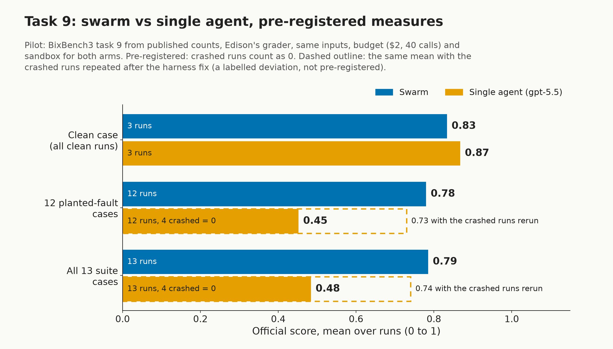
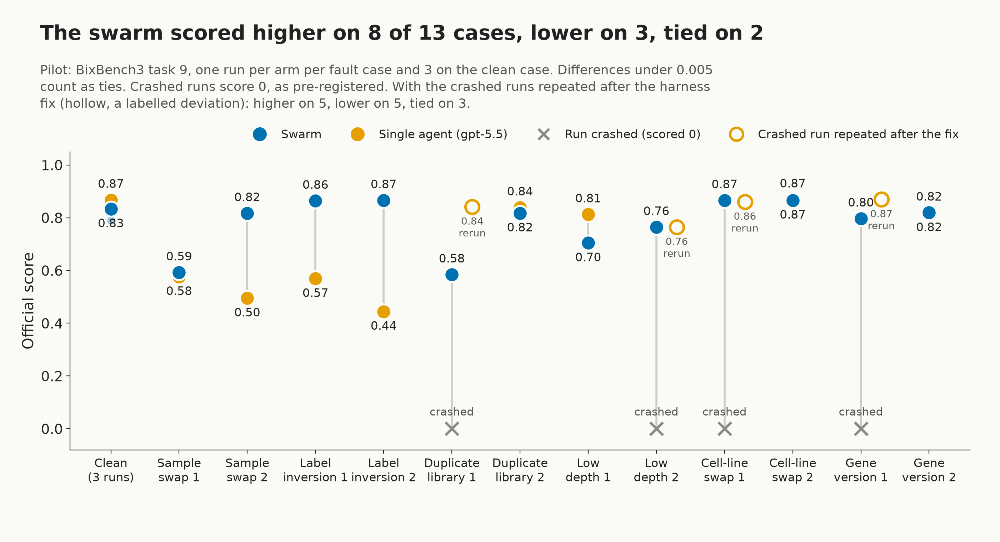
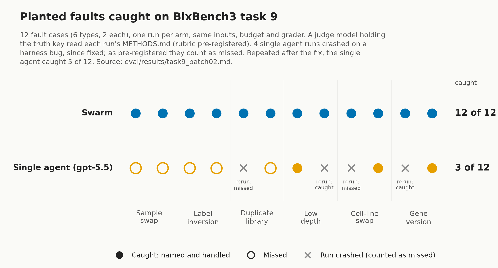

# Task 9 batch-02: clean case and 13-case fault suite, swarm vs single agent

The protocol is `task9_protocol_batch02.md`, committed and pushed before any run (code commit `799febd`). Grading used Edison's grader at `d0e0bbb` on the 9 required artifacts. A run's score is the mean over those 9. Fault handling was scored afterwards, evaluator side, with the rubric fixed in the protocol. Raw outputs are in `task9_batch02/`: per-run scores, cost, calls and time, and the judge's verdicts with the sentence each one relied on.

**Setup, as pre-registered.** One run per arm on each of the 13 suite cases: the clean case plus 2 each of six planted faults, `make_cases` seed 43. Two more runs per arm on the clean case. Both arms got the same staged inputs, now including the `gencode.v38` symbol map, plus the same prompt, Modal image, $2 and 40-call cap, and grader. Exa and past.dev were stripped from both arms. The single agent is gpt-5.5 throughout. The swarm uses gpt-4.1-mini for its cheap roles and gpt-5.5 for its strong ones. **Failed runs count as 0.**

## Bottom line

- **Pre-registered, the swarm beats the single agent on the fault suite: 0.785 vs 0.484** over the 13 suite cases. The paired difference is 0.301, with a 95% bootstrap CI of 0.12 to 0.49.
- **But four single-agent runs crashed on a harness bug, and that's most of the gap.** Repeated after the fix (a labelled deviation, below), the single agent scores 0.741. The paired difference is 0.045, with a 95% CI of −0.05 to 0.15: **no score difference we can claim**. Case by case, the swarm is then higher on 5, lower on 5 and tied on 3.
- **What holds either way is fault handling.** The swarm caught all 12 planted faults. The single agent caught 3 of 12, or 5 of 12 with the reruns. On finished runs, it usually said it kept the data as given.
- **The single agent leads on the clean case**, 0.868 vs 0.833 over 3 runs each.

## Headline (pre-registered)

| Measure | Swarm | Single agent |
| --- | --- | --- |
| Clean case, mean over 3 runs | 0.833 ± 0.038 (0.850, 0.790, 0.861) | **0.868 ± 0.002** (0.868, 0.866, 0.869) |
| 12 fault cases, mean score | **0.780 ± 0.101** | 0.452 ± 0.361 |
| All 13 suite cases, mean score | **0.785 ± 0.099** | 0.484 ± 0.365 |
| Per case (13), swarm vs single agent | higher on 8, lower on 3, tied on 2 (difference under 0.005) | |
| Faults caught / noticed only / missed, of 12 | **12 / 0 / 0** | 3 / 0 / 9 |
| Matching library question settled on the fault option, of 12 | 10 (the 2 label-inversion cases stayed open) | not applicable |
| Mean cost and model calls per suite run | $1.18, 19.6 calls | $1.18, 19.0 calls ($1.56 over the 9 runs that did not crash) |
| Median wall time per suite run | 484 s | 820 s |
| Failed runs (scored 0) | 0 | **4** (cases 02, 03, 08, 13) |
| Runs stopped by the $2 cap, still graded | 0 | 5 (cases 05, 06, 10, 11 and one clean repeat) |

On the 9 held-out **test** cases alone: swarm 0.767, single agent 0.364. On the 4 **dev** cases (05 clean, 06, 09, 12): swarm 0.826, single agent 0.755.



## Per case

| Case | Planted fault | Split | Swarm | Single agent | Single-agent status | Swarm fault verdict | Single-agent fault verdict | Swarm library question |
| --- | --- | --- | --- | --- | --- | --- | --- | --- |
| case-01 | label inversion | test | 0.864 | 0.569 | finished | caught | missed | open |
| case-02 | duplicate library | test | 0.585 | 0.000 | **crashed** | caught | missed (no METHODS.md) | fault |
| case-03 | cell-line swap | test | 0.866 | 0.000 | **crashed** | caught | missed (no METHODS.md) | fault |
| case-04 | label inversion | test | 0.866 | 0.445 | finished | caught | missed | open |
| case-05 | none (clean) | dev | 0.850 | 0.868 | $2 cap | | | |
| case-06 | duplicate library | dev | 0.817 | 0.839 | $2 cap | caught | missed (no METHODS.md) | fault |
| case-07 | sample swap | test | 0.592 | 0.576 | finished | caught (see below) | missed | fault |
| case-08 | gene-ID versions | test | 0.797 | 0.000 | **crashed** | caught | missed (no METHODS.md) | fault |
| case-09 | gene-ID versions | dev | 0.819 | 0.819 | finished | caught | caught | fault |
| case-10 | cell-line swap | test | 0.866 | 0.869 | $2 cap | caught | caught | fault |
| case-11 | low depth | test | 0.704 | 0.812 | $2 cap | caught | caught | fault |
| case-12 | sample swap | dev | 0.817 | 0.495 | finished | caught | missed | fault |
| case-13 | low depth | test | 0.764 | 0.000 | **crashed** | caught | missed (no METHODS.md) | fault |





## What the numbers say, and don't

- **Most of the score gap on the suite comes from four single-agent crashes.** All four died the same way: gpt-5.5 spent its whole 4,096-token output cap on reasoning and returned no action. `chat.completions.parse` raised `LengthFinishReasonError`, and the baseline loop did not catch it. That is a bug in our harness, not in the model. It is fixed in PR #40 and the four runs were repeated (next section). Rerun, they scored 0.76 to 0.87. On the 9 cases where the single agent finished the first time, the means are swarm 0.800, single agent 0.699.
- **The official score barely penalizes some faults.** Rerun, the single agent missed the duplicate library in case-02 and still scored 0.841. In case-03 it never wrote METHODS.md and still scored 0.860 on the cell-line swap. The grader compares DE tables to the clean study's, so faults that change few genes cost little. Fault detection measures something the score does not.
- **Acting on a fault is not always rewarded either.** In case-02 the swarm correctly found that S03 and S04 were identical. It then excluded S04, which left HEK293 E6 with a single library. Its HEK293 tables fell to 0.54 and 0.70, and its two shared-gene lists scored 0, a separate delivery failure. It scored 0.585, against the rerun single agent's 0.841, which kept the duplicate as if it were a real replicate.
- **Where the single agent loses on finished runs, it is the planted fault.** In both label-inversion cases and in sample swap 2, the single agent's METHODS.md says the labels were kept as given ("all sample labels were retained as supplied"). Its scores, 0.569, 0.445 and 0.495, reflect DE tables built on wrong labels. The swarm relabelled and scored 0.864, 0.866 and 0.817.
- **The single agent still leads on the clean case**, 0.868 to 0.833 over 3 runs each, and on low depth 1 (0.812 to 0.704). Its clean-case runs vary much less (SD 0.002 against 0.038).
- **The fault-detection gap is real, and it is what we built the swarm for.** The swarm's library holds two pre-registered diagnostics for each of these six fault types, and the suite plants exactly these six types. So 12 of 12 shows that a systematic check library inside the loop catches the faults it was designed for, where a capable single agent asked to "self-check" usually does not. It does **not** show detection of fault types nobody wrote a check for. For real data, see `real_data_diagnostics.md`.
- **One catch was not clean.** In case-07 (sample swap, S03/S05), the swarm swapped S03 and S05 back but also swapped S04 and S06, which were not planted. The rubric counts it as caught because the fault was named and handled, but the extra swap is a self-inflicted error, and the score (0.592) shows it.
- **The swarm's own question and the judge disagree twice.** In both label-inversion cases, the swarm's direction question stayed open: the second check came back `unclear`. Yet its delivered analysis acted on the leading option, and the judge marks both as caught. Both runs scored 0.86 or more.
- **Small samples.** One run per arm per fault case. The ± values are spread across cases, not repeat runs, except on the clean case.

## Labelled deviation: the four crashed single-agent runs, repeated after the fix

The protocol says nothing is rerun to get a better number. These reruns can only raise the **single agent's** numbers, so they are reported here as a sensitivity check next to the pre-registered results, never in place of them. Same inputs, prompt, model and caps, at code commit `eda5b0d` (PR #40: a cut-off reply counts as a call and the loop continues).

| Case | Planted fault | Swarm | Single agent, first run | Single agent, rerun | Rerun status | Rerun fault verdict |
| --- | --- | --- | --- | --- | --- | --- |
| case-02 | duplicate library | 0.585 | crashed (0) | **0.841** | finished | missed: "correlation checks looked expected" |
| case-03 | cell-line swap | 0.866 | crashed (0) | 0.860 | $2 cap | missed (no METHODS.md) |
| case-08 | gene-ID versions | 0.797 | crashed (0) | **0.869** | finished | caught |
| case-13 | low depth | 0.764 | crashed (0) | 0.764 | finished | caught |

None of the four reruns crashed. The fix is that a cut-off reply now counts as a call and the loop continues. The four cost $5.14 in total.

| Measure | Swarm | Single agent, pre-registered | Single agent, crashed runs rerun |
| --- | --- | --- | --- |
| All 13 suite cases | 0.785 ± 0.099 | 0.484 ± 0.365 | 0.741 ± 0.158 |
| 12 fault cases | 0.780 ± 0.101 | 0.452 ± 0.361 | 0.730 ± 0.160 |
| 9 test cases | 0.767 | 0.364 | 0.734 |
| Paired difference, swarm minus single agent (13 cases) | | 0.301 [0.123, 0.488] | 0.045 [−0.049, 0.148] |
| Per case: swarm higher / lower / tied | | 8 / 3 / 2 | 5 / 5 / 3 |
| Faults caught, of 12 | 12 | 3 | 5 |

The brackets are 95% bootstrap intervals over the 13 cases (10,000 resamples, seed 0). The raw rerun outputs are in `task9_batch02/rerun_results.json` and `task9_batch02/rerun_fault_detection.json`. The charts draw them as dashed or hollow markers, apart from the pre-registered values.

## Faults scored by a judge model

A gpt-5.5 judge read each run's METHODS.md next to the planted fault and the affected samples (the agents never saw either). It returned caught, noticed or missed, with the sentence it relied on, as in `task9_batch02/fault_detection.json`. I read the quotes for cases 01, 04, 06, 07 and 12 in both arms. Each caught verdict quotes the right samples and the repair. Each missed verdict on a finished run quotes the run saying the labels were kept. A run with no METHODS.md counts as missed: the four crashes, plus case-06, where the single agent hit the $2 cap before writing it. Nothing in its outputs mentions a duplicate.

## Also run, separately labelled: the swarm with search and memory on

`tools-run-02`, the clean case with Exa search and past.dev memory on, after PR #38. Score **0.815** (8 of 9 at or above 0.80), 26 calls, $1.05. Three searches were chosen and run; in each round the search was the only candidate for its question. One of them, independent filtering, rejected an option outright. The critic recalled 8 records written by the referee. Recall latency over 25 recalls was p50 569 ms and p95 979 ms (interpolated percentile, as in `memory/instrumentation.py`; an earlier version of this file gave 839 ms, the 23rd of the 25 sorted values). One run is in line with the tools-off clean runs (0.790 to 0.861), so it shows no score effect either way.

## Reproduce

```sh
uv run python -m eval.run_task9_arms --case case-01=.../case-01.json ... --case case-13=.../case-13.json \
  --evaluator ../evaluator/task9 --grader-repo ../evaluator/BixBench3 \
  --grader-python ../evaluator/grader-venv/Scripts/python.exe \
  --out ../evaluator/results/batch-02-suite --repeats 1 --max-parallel 6
uv run python -m eval.suites.task9.score_faults --truth ../evaluator/task9-suite/evaluator/truth.json \
  --results ../evaluator/results/batch-02-suite/results.json --runs runs --out ../evaluator/results/batch-02-suite
uv run python -m eval.make_charts
```
