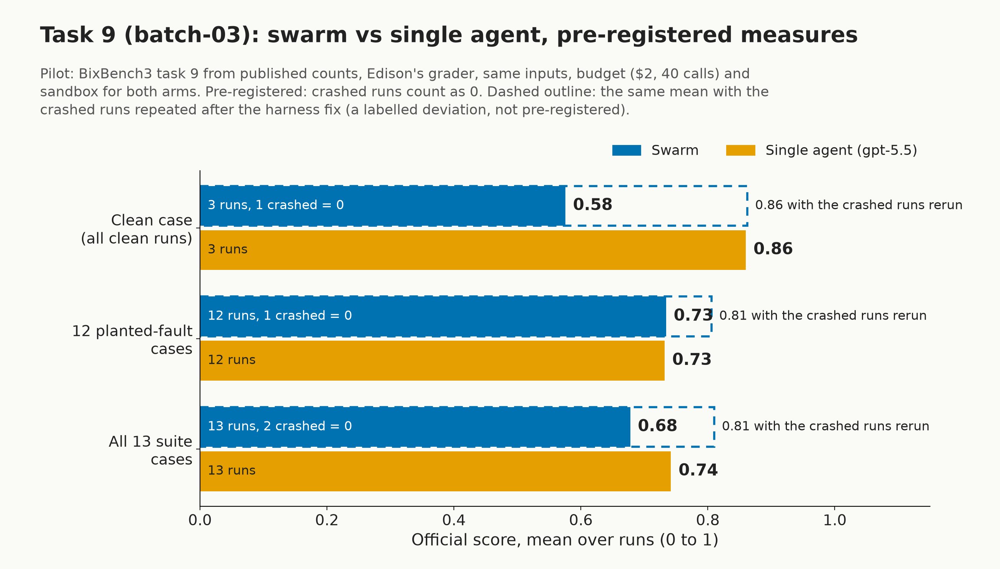
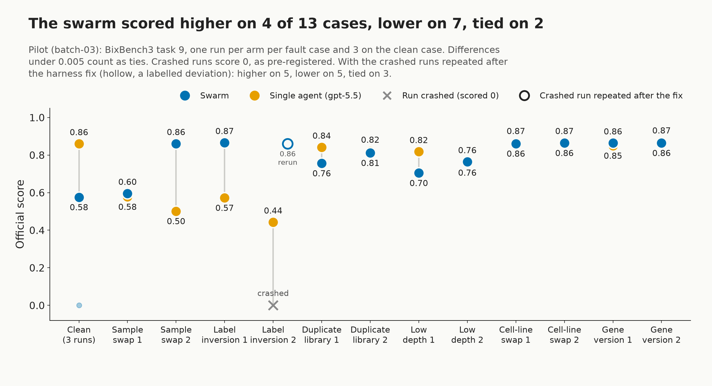
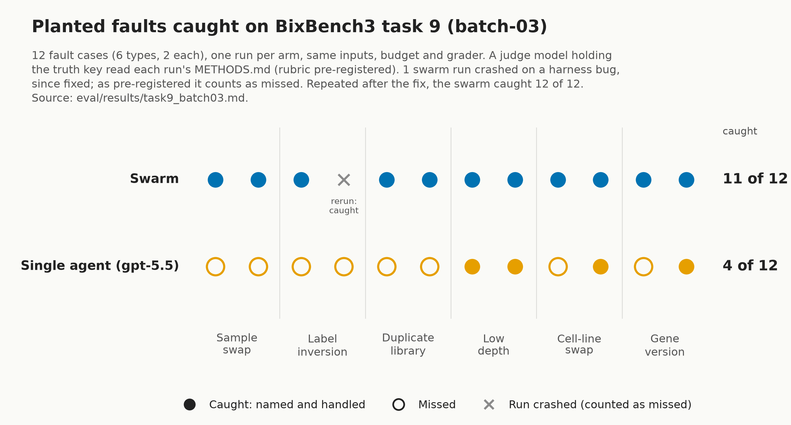

# Task 9 batch-03: the clean-case fix, lessons on vs off, and random selection

The protocol is `task9_protocol_batch03.md`, pushed before any run (PR #48). Everything ran in Modal: orchestration, sandboxes and grading (PR #49). Code commit `19cd67c`, launch id `batch-03`. Edison's grader at `d0e0bbb` scored the 9 required artifacts, and fault handling was judged with the batch-02 rubric. The 52 runs cost $56.93 against the $100 cap, and no run was skipped for budget. Raw outputs are in `task9_batch03/`.

## Bottom line

- **The clean-case gap closed.** The swarm's finished clean runs scored 0.861, 0.866 and 0.861 (the last is a rerun), against 0.861, 0.866 and 0.853 for the single agent. Pre-registered, one swarm clean run crashed and counts as 0, so its 3-run mean reads 0.576.
- **Three swarm runs crashed on a bug in our merge step.** In each, the merge model put an option under the wrong question, and the code raised instead of dropping the bad grouping. It's fixed in PR #54 and the three runs were repeated: a labelled deviation, the same treatment the single agent's crashes got in batch-02.
- **Score:** tied once the crashes are rerun. The swarm's mean over 13 cases is 0.810 against 0.742; the paired difference is +0.068 with a 95% interval of −0.013 to +0.167. Case by case: higher on 5, lower on 5, tied on 3.
- **Fault handling holds.** The swarm caught 12 of 12 planted faults, 11 pre-registered plus the rerun. The single agent caught 4, and named 2 more without fixing them.
- **Lessons made no measurable difference:** +0.010 on the 9 held-out cases (interval −0.059 to +0.089).
- **Random experiment selection did as well as information-gain selection on this suite.** Scores were identical (0.810 vs 0.810), cost was the same ($1.13 vs $1.14 per run), and faults caught were 12 vs 11. Crux's selection rule showed no measurable advantage here, as in the BoxingGym study (DU-41).

## Pre-registered measures (crashed runs count as 0)

| Measure | Swarm | Single agent (gpt-5.5) |
| --- | --- | --- |
| Clean case, 3 runs | 0.576 (0.000, 0.861, 0.866) | **0.860** (0.861, 0.866, 0.853) |
| 12 fault cases | 0.734 ± 0.246 | 0.732 ± 0.160 |
| All 13 suite cases | 0.678 ± 0.311 | 0.742 ± 0.158 |
| 9 test cases | 0.697 | 0.733 |
| Paired difference, 13 cases (95% CI) | −0.064 (−0.242 to 0.080) | |
| Per case: swarm higher / lower / tied | 4 / 7 / 2 | |
| **Faults caught / noticed only / missed, of 12** | **11 / 0 / 1** (the miss is a crashed run) | 4 / 2 / 6 |
| Failed runs | 2 (merge crash: case-04, case-05) | 0 |
| Runs stopped by the $2 cap, still graded | 1 (case-07) | 6 |
| Mean cost, calls, median time per suite run | $0.93, 16.5, 278 s | $1.34, 18.8, 305 s |

| Arm on its cases | Mean score | Faults caught | Failed runs | Mean cost |
| --- | --- | --- | --- | --- |
| Swarm, lessons on (9 test cases) | 0.708 | 8 of 9 (the miss is a crashed run) | 1 (merge crash: case-07) | $0.90 |
| Swarm, lessons off (the suite arm on the same 9) | 0.697 | 8 of 9 (the miss is a crashed run) | 1 (case-04) | |
| Swarm, random selection (13 cases) | 0.810 ± 0.084 | 11 of 12 (missed the case-06 duplicate) | 0 | $1.14 |



## Labelled deviation: the three crashed swarm runs, repeated after the fix

The protocol says nothing is rerun to get a better number. As in batch-02, a run killed by a harness bug is repeated once after the fix and reported next to the pre-registered numbers, never in place of them. Same inputs, models and caps, at commit `8ffac76` (PR #54: a malformed merge plan keeps every proposal unmerged instead of ending the run). The three reruns cost $3.43.

| Run | Planted fault | First run | Rerun | Rerun fault verdict |
| --- | --- | --- | --- | --- |
| suite case-04, swarm | label inversion | crashed (0) | **0.861** | caught |
| suite case-05, swarm | none (clean) | crashed (0) | **0.861** | |
| lessons case-07, swarm with lessons | sample swap | crashed (0) | **0.861** | caught |

| Measure | Swarm, crashed runs rerun | Single agent |
| --- | --- | --- |
| Clean case, 3 runs | **0.862** (0.861, 0.861, 0.866) | 0.860 |
| 12 fault cases | 0.806 ± 0.086 | 0.732 ± 0.160 |
| All 13 suite cases | 0.810 ± 0.084 | 0.742 ± 0.158 |
| 9 test cases | 0.793 | 0.733 |
| Paired difference, 13 cases (95% CI) | +0.068 (−0.013 to 0.167) | |
| Per case: higher / lower / tied | 5 / 5 / 3 | |
| **Faults caught, of 12** | **12** | 4 (plus 2 noticed) |
| Lessons on minus off, 9 test cases (95% CI) | +0.010 (−0.059 to 0.089) | |
| Information-gain minus random selection, 13 cases (95% CI) | −0.000 (−0.001 to 0.001) | |
| Mean cost per suite run: information gain vs random | $1.13 vs $1.14 | $1.34 |

Intervals are 95% bootstrap intervals over cases (10,000 resamples, seed 0).





## Per case

| Case | Planted fault | Split | Swarm | Single agent | Random selection | Lessons on | Swarm fault verdict | Single-agent fault verdict |
| --- | --- | --- | --- | --- | --- | --- | --- | --- |
| case-01 | label inversion | test | 0.866 | 0.572 | 0.866 | 0.861 | caught | missed |
| case-02 | duplicate library | test | 0.756 | 0.841 | 0.755 | 0.758 | caught | noticed |
| case-03 | cell-line swap | test | 0.861 | 0.866 | 0.861 | 0.869 | caught | missed |
| case-04 | label inversion | test | crashed (rerun 0.861) | 0.443 | 0.861 | 0.866 | missed (rerun: caught) | missed |
| case-05 | none (clean) | dev | crashed (rerun 0.861) | 0.861 | 0.861 | | | |
| case-06 | duplicate library | dev | 0.811 | 0.820 | 0.811 | | caught | missed |
| case-07 | sample swap | test | 0.596 | 0.578 | 0.596 | crashed (rerun 0.861) | caught | missed |
| case-08 | gene-ID versions | test | 0.864 | 0.850 | 0.861 | 0.861 | caught | noticed |
| case-09 | gene-ID versions | dev | 0.864 | 0.869 | 0.866 | | caught | caught |
| case-10 | cell-line swap | test | 0.864 | 0.866 | 0.864 | 0.866 | caught | caught |
| case-11 | low depth | test | 0.704 | 0.818 | 0.704 | 0.703 | caught | caught |
| case-12 | sample swap | dev | 0.861 | 0.501 | 0.866 | | caught | missed |
| case-13 | low depth | test | 0.764 | 0.759 | 0.764 | 0.585 | caught | caught |

## Against the expectations stated in advance

1. **The clean-case gap closes to within 0.01:** met on finished runs (0.862 vs 0.860 with the rerun). Not met pre-registered, because of the crash.
2. **The swarm catches at least 10 of 12 faults, more than the single agent:** met (11 pre-registered, 12 with the rerun, against 4).
3. **No direction predicted for fault-case scores:** tied pre-registered (0.734 vs 0.732). With the rerun the swarm is ahead, but the interval includes zero.
4. **Lessons:** no measurable effect, as expected with 9 cases.
5. **Random selection should catch fewer faults or spend more:** not observed. Random caught 11 of 12 (the swarm 12), at the same score and cost.

## What the numbers say, and don't

- **The clean-case fix (PR #47) did what it was written for.** In batch-02, the swarm's clean runs varied with whichever filter it guessed for an untested question (0.790 to 0.861). In batch-03 every finished clean run scored 0.861 or 0.866. That rule was written after seeing clean-case grades, so clean-case scores count as tuned.
- **Fault handling is still the clear difference, with the same caveat.** The swarm's library has checks for exactly these six fault types. Where the single agent finished and missed a label inversion or sample swap, it kept the labels as given and scored 0.443 to 0.578; the swarm relabelled and scored 0.861 to 0.866.
- **Information-gain selection did not beat random selection here.** With about a dozen library diagnostics and a $2 budget, random order still reaches the diagnostics that matter. The per-case scores of the two arms are almost identical. The selection rule may matter with a larger diagnostic space or a tighter budget, but this pilot doesn't show it.
- **Lessons:** with 9 cases and a +0.010 effect, there's nothing to claim. Case by case they helped on case-07 (0.861 vs 0.596) and hurt on case-13 (0.585 vs 0.764).
- **Small samples:** one run per arm per fault case. The single agent hit the $2 cap in 6 of 13 suite runs and was still graded.

## Reproduce

```sh
uv run python -m modal run --detach eval/cloud.py --jobs eval/results/task9_batch03_jobs.json --max-total-usd 100 --launch-id batch-03
uv run python -m eval.cloud fetch --launch batch-03 --to ../evaluator/results
uv run python -m eval.make_charts --task9 eval/results/task9_batch03/suite_results.json eval/results/task9_batch03/clean_results.json \
  --faults eval/results/task9_batch03/suite_fault_detection.json --reruns eval/results/task9_batch03/rerun_results.json \
  --rerun-faults eval/results/task9_batch03/rerun_fault_detection.json --label " (batch-03)" \
  --source eval/results/task9_batch03.md --out docs/figures/batch-03
```
