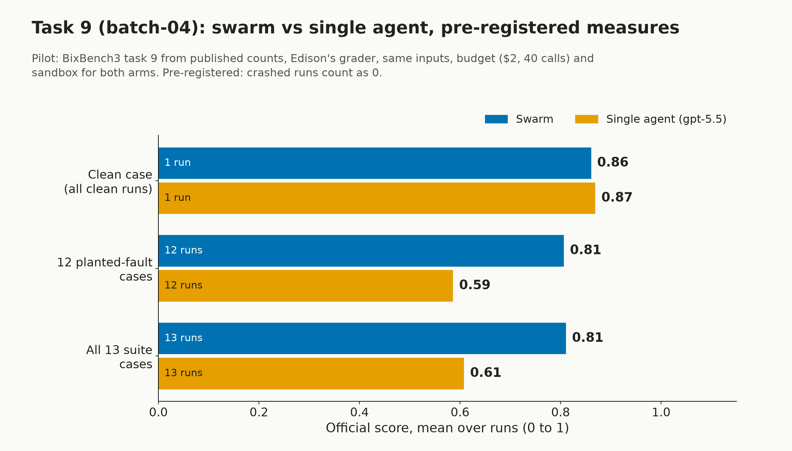
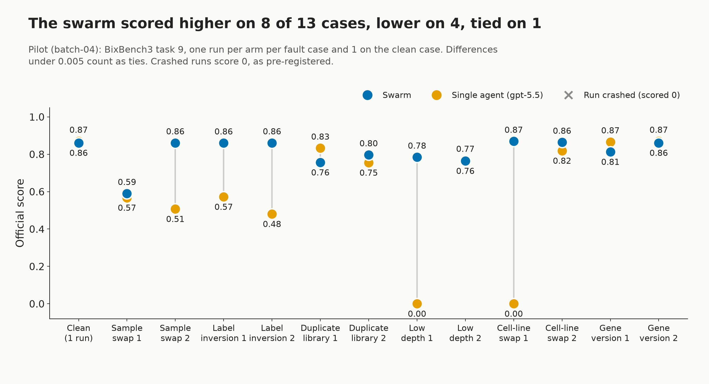
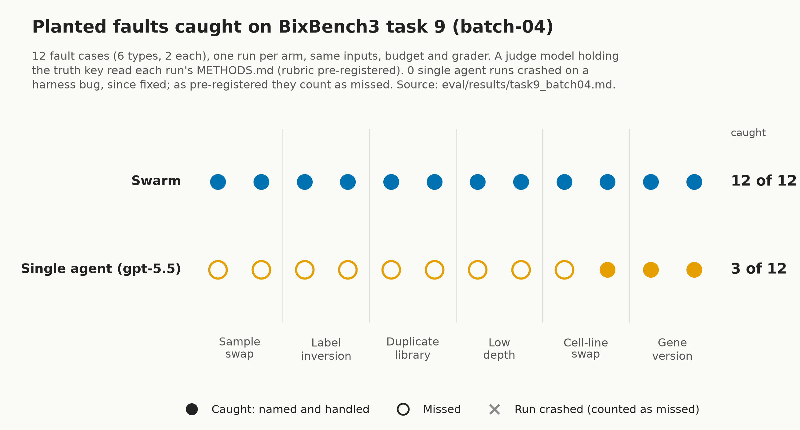

# Task 9 batch-04: a fresh held-out suite (DU-55)

The protocol is `task9_protocol_batch04.md`, pushed before any run (PR #59). This is the first batch on cases nobody had run, graded or tuned on: `make_cases --seed 44`, 13 cases, with no input bundle shared with the seed-43 suite. Everything ran in Modal at commit `95aaa11`, launch id `batch-04`. Edison's grader at `d0e0bbb` scored the 9 required artifacts, and fault handling was judged with the batch-02 rubric against the seed-44 truth key. The 26 runs cost $33.14 against the $45 cap; none was skipped, **none crashed, and nothing was rerun.** Raw outputs are in `task9_batch04/`.

## Bottom line

- **The swarm scored higher, and the interval excludes zero.** All 13 cases: **0.811 against 0.608**, a paired difference of **+0.203 (95% CI +0.048 to +0.382)**. Case by case: higher on 8, lower on 4, tied on 1.
- **Fault handling:** the swarm caught **12 of 12** planted faults. The single agent caught 3, and named 2 more without fixing them.
- **The clean case is level:** 0.861 against 0.869, one run each.
- **Cost:** the swarm spent less per run, $1.17 against $1.38. The single agent hit the $2 cap in 7 of 13 runs.

## Pre-registered measures

| Measure | Swarm | Single agent (gpt-5.5) |
| --- | --- | --- |
| All 13 cases | **0.811 ± 0.078** | 0.608 ± 0.305 |
| 12 fault cases | **0.807 ± 0.080** | 0.586 ± 0.307 |
| Clean case (`h44-case-12`), one run | 0.861 | 0.869 |
| Paired difference, 13 cases (95% CI) | **+0.203 (+0.048 to +0.382)** | |
| Paired difference, 12 fault cases (95% CI) | +0.220 (+0.056 to +0.407) | |
| Per case: swarm higher / lower / tied | 8 / 4 / 1 | |
| **Faults caught / noticed only / missed, of 12** | **12 / 0 / 0** | 3 / 2 / 7 |
| Matching library question settled on the fault option | 10 of 12 (the 2 label inversions stayed open) | not applicable |
| Failed runs | 0 | 0 |
| Runs stopped by the $2 cap, still graded | 0 | 7 |
| Mean cost, calls, median time per run | $1.17, 19.2, 362 s | $1.38, 21.2, 290 s |

Intervals are 95% bootstrap intervals over cases (10,000 resamples, seed 0).



## The single agent's two zero scores

Both count as scored, as pre-registered. Neither was a crash, and neither was rerun.

- **`h44-case-01` (cell-line swap): 0.000.** The agent finished after 7 calls and $0.16, reporting that `/data` contained no inputs, and wrote placeholder files rather than invent data. The inputs were there: the sandbox's own check verified every file and its hash under `/data` before the run started (`execution/sandbox.py`). In this sandbox `/data` is a symlink to the mounted volume. The agent's listings (`ls -la`, then a search) didn't follow it, so in 61 lines of output it never saw a file. The other 12 single-agent runs found their inputs, and the swarm scored 0.869 on this case. This is a single-agent failure, triggered by a quirk of our sandbox.
- **`h44-case-07` (low depth): 0.000.** The agent used 27 calls and hit the $2 cap without producing gradable outputs.

**Sensitivity, not pre-registered:**

| Check | Swarm | Single agent | Paired difference (95% CI) |
| --- | --- | --- | --- |
| `h44-case-01` left out of both arms (12 cases) | 0.806 | 0.659 | +0.147 (+0.025 to +0.299) |
| Both zero-score cases left out of both arms (11 cases) | 0.808 | 0.718 | +0.089 (+0.002 to +0.189) |

The second check removes the single agent's two worst runs and none of the swarm's, so it can only favour the single agent. The swarm stays ahead, by a margin that just excludes zero.

## Per case

| Case | Planted fault | Swarm | Single agent | Single-agent status | Swarm fault verdict | Single-agent fault verdict |
| --- | --- | --- | --- | --- | --- | --- |
| h44-case-01 | cell-line swap | 0.869 | 0.000 | finished (empty-input belief) | caught | missed |
| h44-case-02 | cell-line swap | 0.864 | 0.819 | $2 cap | caught | caught |
| h44-case-03 | duplicate library | 0.756 | 0.833 | $2 cap | caught | noticed |
| h44-case-04 | sample swap | 0.590 | 0.567 | $2 cap | caught | missed |
| h44-case-05 | label inversion | 0.860 | 0.572 | finished | caught | missed |
| h44-case-06 | duplicate library | 0.797 | 0.755 | $2 cap | caught | noticed |
| h44-case-07 | low depth | 0.784 | 0.000 | $2 cap | caught | missed |
| h44-case-08 | gene-ID versions | 0.813 | 0.866 | finished | caught | caught |
| h44-case-09 | low depth | 0.764 | 0.767 | $2 cap | caught | missed |
| h44-case-10 | gene-ID versions | 0.861 | 0.869 | finished | caught | caught |
| h44-case-11 | sample swap | 0.861 | 0.507 | finished | caught | missed |
| h44-case-12 | none (clean) | 0.861 | 0.869 | $2 cap | | |
| h44-case-13 | label inversion | 0.861 | 0.480 | finished | caught | missed |





## Against the expectations stated in advance

1. **The swarm catches at least 10 of 12 faults, and more than the single agent:** met (12 against 3).
2. **No directional prediction for fault-case scores:** the swarm scored higher, +0.220 (+0.056 to +0.407).
3. **The clean case stays near batch-03's level** (about 0.86 for both): met (0.861 and 0.869).

## What the numbers say, and don't

- **On cases nobody tuned on, the swarm held up and the single agent didn't.** The single agent's losses are the planted faults (it kept inverted or swapped labels and scored 0.480 to 0.572) and the budget (7 of 13 runs hit the $2 cap). The swarm caught every fault and stayed under the cap.
- **The same caveat as before:** the swarm's library has checks for exactly these six fault types. This shows systematic checking catches the faults it was built for, on new instances of them. It doesn't show detection of fault types nobody wrote a check for.
- **One run per arm per case,** on one task, from published counts. It's a pilot.
- **Batch-03, on the reused seed-43 suite, found the scores tied.** The difference here comes mostly from cases where the single agent missed the fault, failed outright, or ran out of budget. More repeats would tell how much of that is run-to-run variance.

## Reproduce

```sh
uv run python -m eval.suites.task9.make_cases --counts <counts> --samples <samples> --output ../evaluator/task9-suite-h44 --seed 44
uv run python -m modal run --detach eval/cloud.py --jobs eval/results/task9_batch04_jobs.json --max-total-usd 45 --launch-id batch-04
uv run python -m eval.make_charts --task9 eval/results/task9_batch04/suite_results.json \
  --faults eval/results/task9_batch04/suite_fault_detection.json --reruns \
  --label " (batch-04)" --source eval/results/task9_batch04.md --out docs/figures/batch-04
```
