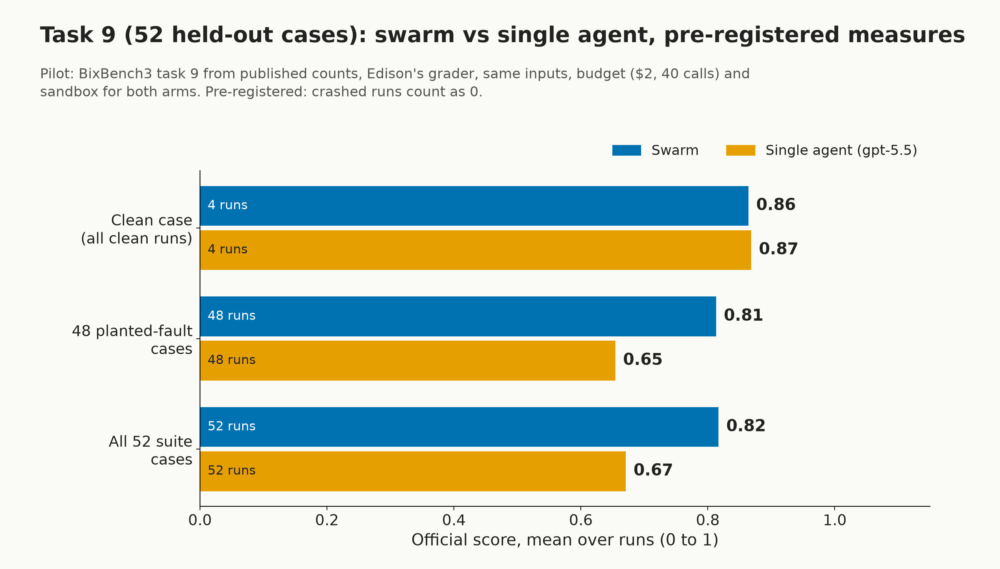
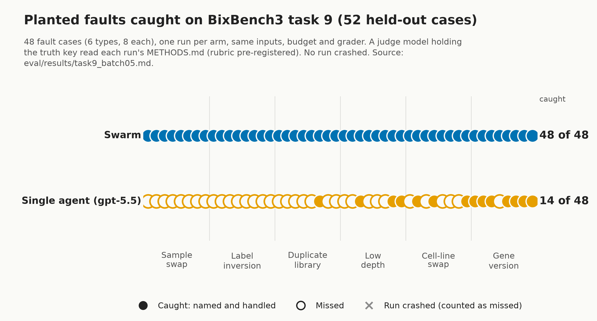

# Task 9 batch-05: three more fresh held-out suites, and the 52-case result

The protocol is `task9_protocol_batch05.md`, pushed before any run (PR #72). Batch-05 ran both arms once on three suites made fresh for it: `make_cases` seeds 45, 46 and 47, 39 cases, with no input bundle shared with any earlier suite. They ran as three Modal launches at the same time (`batch-05-h45`, `-h46`, `-h47`), each with its own orchestrator, results folder and $45 cap, at commit `3f09a28`. Edison's grader at `d0e0bbb` scored the 9 required artifacts, and fault handling was judged with the batch-02 rubric against each suite's truth key.

All 78 runs finished in about 20 minutes of wall-clock time and cost $104.94 ($35.88, $33.65 and $35.41). **None crashed and nothing was rerun.** Raw outputs are in `task9_batch05_h45/`, `task9_batch05_h46/` and `task9_batch05_h47/`. The combined numbers are in `task9_heldout_summary.json`, made by `eval/heldout_summary.py`, which reproduces batch-04's published numbers exactly (`tests/test_heldout_summary.py`).

## The headline: all 52 held-out cases (batch-04 and batch-05)

| Measure | Swarm | Single agent (gpt-5.5) |
| --- | --- | --- |
| All 52 cases | **0.817 ± 0.081** | 0.671 ± 0.231 |
| 48 fault cases | **0.813** | 0.654 |
| Clean cases, 4 runs (one per suite) | 0.864 (0.861, 0.866, 0.866, 0.864) | 0.868 (0.869, 0.866, 0.869, 0.869) |
| Paired difference, 52 cases (95% CI) | **+0.146 (+0.084 to +0.215)** | |
| Per case: swarm higher / lower / tied (within 0.005) | 27 / 13 / 12 | |
| **Faults caught / noticed only / missed, of 48** | **48 / 0 / 0** | 14 / 6 / 28 |
| Mean cost per run | $1.18 | $1.47 |
| Runs stopped by the $2 cap, still graded | 0 | 27 |
| Runs that crashed | 0 | 0 |

Intervals are 95% bootstrap intervals over cases (10,000 resamples, seed 0).

## Per suite

| Suite | Swarm | Single agent | Paired difference (95% CI) | Higher / lower / tied | Faults caught, swarm vs single agent | Spend |
| --- | --- | --- | --- | --- | --- | --- |
| seed 44 (batch-04) | 0.811 | 0.608 | +0.203 (+0.048 to +0.382) | 8 / 4 / 1 | 12 vs 3 | $33.14 |
| seed 45 | 0.833 | 0.710 | +0.123 (+0.033 to +0.217) | 7 / 2 / 4 | 12 vs 3 | $35.88 |
| seed 46 | 0.813 | 0.666 | +0.147 (+0.053 to +0.253) | 7 / 3 / 3 | 12 vs 3 | $33.65 |
| seed 47 | 0.812 | 0.700 | +0.112 (−0.010 to +0.276) | 5 / 4 / 4 | 12 vs 5 | $35.41 |
| **batch-05 only (39 cases)** | **0.819** | **0.692** | **+0.127 (+0.065 to +0.196)** | 19 / 9 / 11 | **36 vs 11** | $104.94 |

## What this says, and doesn't

- **The batch-04 result held on 39 more fresh cases.** Batch-05 alone gives +0.127 (+0.065 to +0.196); all 52 cases together give +0.146 (+0.084 to +0.215). The estimate shrank from batch-04's +0.203, as the protocol said it might, and the interval narrowed.
- **One suite's interval includes zero.** On seed 47 the difference is +0.112 (−0.010 to +0.276). We report it as is.
- **Fault handling is the consistent difference.** The swarm caught all 48 planted faults across the four suites; the single agent caught 14, noticed 6 more without acting on them, and missed 28. The pre-registered expectation (at least 10 of 12 per suite, and more than the single agent) held in every suite.
- **No result depends on zero scores.** Batch-05 had one single-agent zero (seed 47, `h47-case-03`: it hit the $2 cap with no gradable outputs), and batch-04 had two. Leaving out all three cases, which can only favour the single agent, the 49-case difference is +0.104 (+0.057 to +0.154).
- **The clean cases are level:** 0.864 against 0.868 over four runs each.
- **The same caveats as batch-04.**
  - The swarm's library has checks for exactly these six fault types, so this shows a check library in the loop catches the faults it was written for, not unknown faults.
  - It is one task of 20, from published counts, with one run per arm per case.
  - The single agent hit the $2 cap in 27 of 52 runs and was still graded.

## Deviations from the protocol

**Fault scoring was re-run.** In each launch, the cloud step that scores fault handling ran but matched no cases, because the uploaded truth files named the cases `case-NN` while the runs were named `h45-case-NN` (batch-04's uploaded truth had been renamed by hand; batch-05's had not). We renamed the cases in each truth file the same way, re-uploaded them, and ran the same scorer (`eval.suites.task9.score_faults`), with the same judge and rubric, on the fetched runs. Grades and run outputs were unaffected; only this scoring step was repeated.

## Expectations stated in advance

1. **Fault handling, at least 10 of 12 per suite and more than the single agent:** met in every suite (12, 12 and 12, against 3, 3 and 5).
2. **Score:** no directional prediction per suite. Combined, +0.146 (+0.084 to +0.215).
3. **Clean cases at about 0.86 for both arms:** 0.864 and 0.868.

## Commands

```sh
uv run python -m eval.suites.task9.make_cases --counts <counts> --samples <samples> --output ../evaluator/task9-suite-h45 --seed 45   # and 46, 47
uv run python -m modal run --detach eval/cloud.py --jobs eval/results/task9_batch05_h45_jobs.json --max-total-usd 45 --launch-id batch-05-h45   # and h46, h47
uv run python -m eval.heldout_summary eval/results/task9_batch04 eval/results/task9_batch05_h45 eval/results/task9_batch05_h46 eval/results/task9_batch05_h47 --json eval/results/task9_heldout_summary.json
uv run python -m eval.make_charts --task9 eval/results/task9_heldout_all/suite_results.json --faults eval/results/task9_heldout_all/suite_fault_detection.json --reruns --label " (52 held-out cases)" --source eval/results/task9_batch05.md --out docs/figures/batch-05
```




